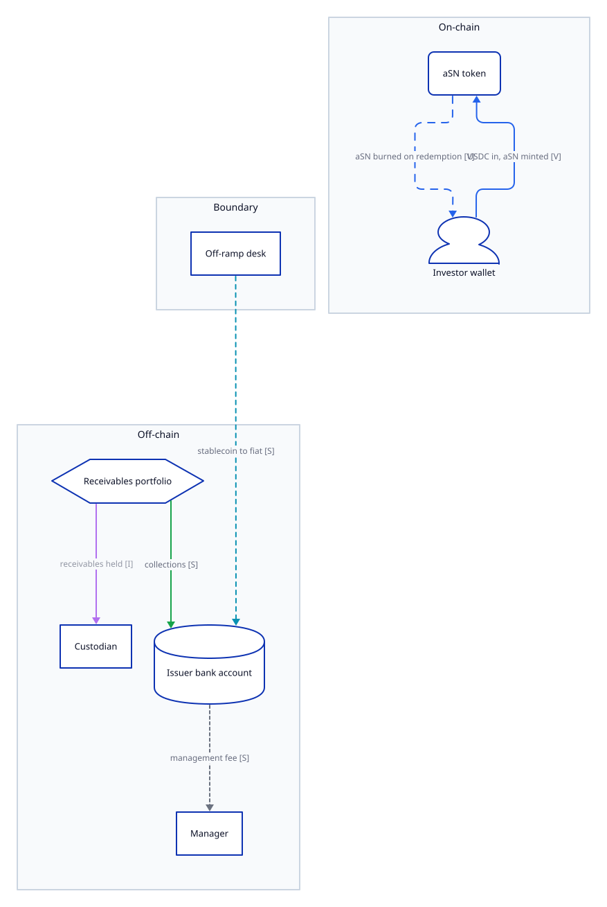
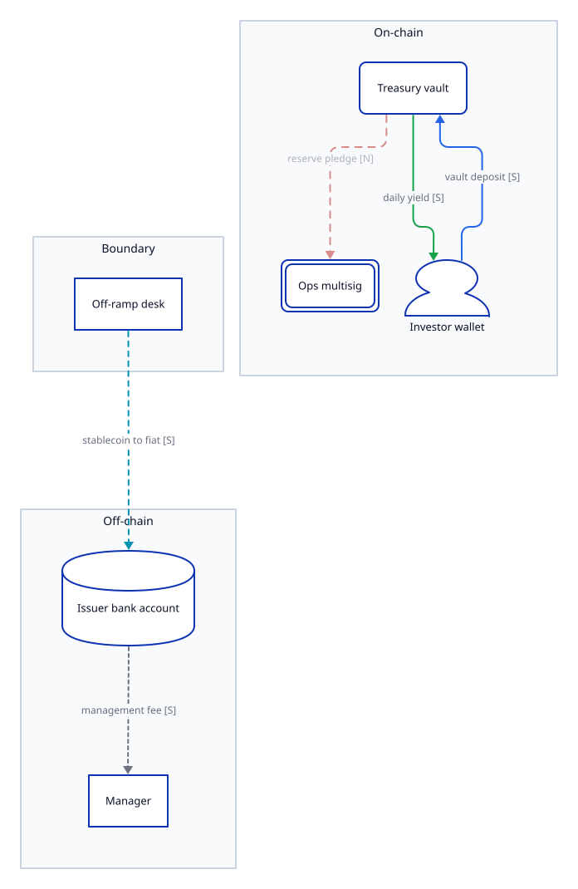

# RWA Due Diligence: Acme Yield

| field | value |
|---|---|
| slug | acme |
| root URL | https://acme-yield.example/ |
| run id | acme-20261001T080000Z |
| status | draft |
| rounds | 1 |
| started | 2026-10-01T08:00:00Z |
| finalized | -- |
| skill version | 0.1.0 |
| schema version | rwa-dd/1.0 |

> DRAFT -- not finalized

## 1. Executive summary

Acme Yield offers two products: a receivables-backed note (P1) and a treasury bill vault (P2). The issuer and the manager are registered; custody and loss order are not documented in public sources.

## 2. Blocking gaps and materials to request

- **G1** [legal] Issuer financial statements and the custody agreement are not public. (S8)
  - **N1** Custody agreement and issuer accounts -- Company registry filings -- Confirm custody and financials (resolves G1; est 6 calls)

## 3. Products

- Project name: Acme Yield [S] (S1)
- Asset class: trade receivables; treasury bills [S] (S1)

| id | name | symbol | chains | token addresses | asset class |
|---|---|---|---|---|---|
| P1 | Acme Senior Note [S] (S8) | aSN [V] (S4) | ethereum [V] (S4) | 0x00000000000000000000000000000000000000a1 [V] (S4) | trade receivables [S] (S8) |
| P2 | Acme Treasury Vault [S] (S7) -- Name taken from archived docs. | aTV [S] (S1) | ethereum [S] (S1) | -- [N] (S1, S4) -- No vault address published on the site or found on the explorer. | treasury bills [S] (S7) |

## 4. Legal structure

### Entities

| id | legal name | jurisdiction | entity type | registration id | roles | license status |
|---|---|---|---|---|---|---|
| E1 | Acme Yield Issuer Ltd [V] (S3) | Examplestan [V] (S3) | private limited company [V] (S3) | 100200 [V] (S3) | issuer; spv | -- [N] (S2) -- No licence entry found for the issuer. |
| E2 | Acme Asset Management LLC [V] (S2) | Examplestan [I] (S2) -- Regulator only licenses local entities. | limited liability company [S] (S8) | -- [N?] | manager | active [V] (S2) |
| E3 | Example Custody Trust Co [S] (S8) | -- [N] (S8) -- Memorandum names the custodian but not its jurisdiction. | trust company [I] (S5) -- Name suggests a trust company. | -- [N?] | custodian | -- [N?] |
| E4 | Acme Labs Inc [S] (S1) | -- [N?] | -- [N?] | -- [N?] | developer; platform_operator | -- [N?] |

| entity | regulator | license type | license id | license status |
|---|---|---|---|---|
| E2 | Examplestan Financial Authority [V] (S2) | fund manager [V] (S2) | AAM-0042 [V] (S2) | active [V] (S2) |

### Relationships

| from | to | type | claim |
|---|---|---|---|
| E4 | E1 | controls | true [I] (S5) -- Third-party review links the issuer to Acme Labs. |
| E2 | P1 | manages | true [S] (S8) |
| E3 | P1 | custodies | true [S] (S8) |

### Governing law

Examplestan [S] (S8)

## 5. Yield source

### P1 Acme Senior Note

- Mechanism: Interest on receivables purchased at a discount [S] (S8)
- Gross yield: 11.0 percent [S] (S1)
- Net yield to holder: 9.5 percent [S] (S1)
- Distribution method: rebasing [V] (S4)
- Distribution frequency: monthly [S] (S8)
- Loss absorption: -- [N] (S8) -- Memorandum does not describe loss order.

Underlying:

| description | asset class | share pct | location |
|---|---|---|---|
| Short-dated trade receivables [S] (S8) | trade receivables [S] (S8) | 100 [S] (S8) | -- [N] (S8) -- Receivables jurisdiction not stated. |

Fees:

| type | rate | recipient |
|---|---|---|
| management [S] (S8) | 1.5 percent p.a. [S] (S8) | E2 [S] (S8) |

### P2 Acme Treasury Vault

- Mechanism: Treasury bill coupons passed through the vault [S] (S7)
- Gross yield: -- [N?]
- Net yield to holder: 4.1 percent [S] (S1)
- Distribution method: claim [S] (S7)
- Distribution frequency: daily [S] (S7)
- Loss absorption: -- [N?]

Underlying:

| description | asset class | share pct | location |
|---|---|---|---|
| Short-term treasury bills [S] (S7) | treasury bills [S] (S7) | -- [N?] | -- [N?] |

Fees:

| type | rate | recipient |
|---|---|---|
| vault [S] (S7) | 0.30 percent [S] (S7) | -- [N?] |

## 6. Fund flows

Nodes:

| id | label | lane | kind | chain | ref |
|---|---|---|---|---|---|
| n1 | Investor wallet | onchain | investor | ethereum | -- |
| n2 | aSN token | onchain | contract | ethereum | 0x00000000000000000000000000000000000000a1 |
| n3 | Treasury vault | onchain | pool | ethereum | P2 |
| n4 | Ops multisig | onchain | multisig | ethereum | 0x00000000000000000000000000000000000000b2 |
| n5 | Off-ramp desk | boundary | entity | -- | E4 |
| n6 | Issuer bank account | offchain | bank_account | -- | E1 |
| n7 | Custodian | offchain | entity | -- | E3 |
| n8 | Receivables portfolio | offchain | asset | -- | -- |
| n9 | Manager | offchain | entity | -- | E2 |

### P1 Acme Senior Note

| from | to | kind | mechanism | rail | label | claim |
|---|---|---|---|---|---|---|
| n1 Investor wallet | n2 aSN token | subscription | deposit | stablecoin | USDC in, aSN minted | true [V] (S4) |
| n5 Off-ramp desk | n6 Issuer bank account | conversion | conversion | fiat_wire | stablecoin to fiat | true [S] (S1) |
| n8 Receivables portfolio | n7 Custodian | custody | title_transfer | internal | receivables held | true [I] (S5) -- Review mentions a custodian. |
| n8 Receivables portfolio | n6 Issuer bank account | yield | interest | fiat_wire | collections | true [S] (S8) |
| n6 Issuer bank account | n9 Manager | fee | fee_payment | fiat_wire | management fee | true [S] (S8) |
| n2 aSN token | n1 Investor wallet | redemption | burn | burn | aSN burned on redemption | true [V] (S4) |

### P2 Acme Treasury Vault

| from | to | kind | mechanism | rail | label | claim |
|---|---|---|---|---|---|---|
| n5 Off-ramp desk | n6 Issuer bank account | conversion | conversion | fiat_wire | stablecoin to fiat | true [S] (S1) |
| n6 Issuer bank account | n9 Manager | fee | fee_payment | fiat_wire | management fee | true [S] (S8) |
| n3 Treasury vault | n4 Ops multisig | collateral | pledge | internal | reserve pledge | -- [N] (S4) -- No pledge transfer observed on-chain. |
| n1 Investor wallet | n3 Treasury vault | subscription | deposit | stablecoin | vault deposit | true [S] (S7) |
| n3 Treasury vault | n1 Investor wallet | yield | distribution | stablecoin | daily yield | true [S] (S7) |

## 7. On-chain contracts and control

| chain | address | role | source verified | proxy | upgrade admin | role admins | timelock delay s | multisig | threshold | signers |
|---|---|---|---|---|---|---|---|---|---|---|
| ethereum | 0x00000000000000000000000000000000000000a1 | aSN token [V] (S4) | true [V] (S4) | TransparentUpgradeableProxy [V] (S4) | 0x00000000000000000000000000000000000000b2 [V] (S4) | 0x00000000000000000000000000000000000000b2 [V] (S4) | 0 [V] (S4) -- No timelock between admin and proxy. | 0x00000000000000000000000000000000000000b2 [V] (S4) | 2 [V] (S4) | 3 [V] (S4) |

## 8. Redemption and eligibility

Redemption:

| product | mechanism | queue | settlement time | gating | fees |
|---|---|---|---|---|---|
| P1 | redemption request to issuer [S] (S8) | monthly window [S] (S8) | 2 business days [I] (S6) -- Stated on an analyst call only. | issuer may suspend redemptions [S] (S8) | -- [N] (S8) -- No redemption fee stated. |
| P2 | instant burn against vault liquidity [S] (S7) | -- [N?] | -- [N?] | -- [N?] | -- [N?] |

Eligibility:

| product | restrictions |
|---|---|
| P1 | professional investors only [S] (S8) |
| P2 | -- [N] (S1) -- Site does not state restrictions. |

## 9. Audits

| auditor | scope | date | report |
|---|---|---|---|
| Example Audit Partners [S] (S1) | aSN token contract [S] (S1) | 2026-02-15 [S] (S1) | -- |

## 10. Size

| product | metric | value | as of |
|---|---|---|---|
| P1 | supply | 12500000 [V] (S4) | 2026-10-01 |
| P2 | tvl | 3400000 [S] (S1) | 2026-10-01 |
| -- | originated | 48000000 [S] (S1) | -- |

## 11. History

| date | change | evidence |
|---|---|---|
| 2026-03-01 | Vault fee stated as 0.30 percent in archived docs. | S7 |
| 2026-09-15 | Upgrade admin moved to a 2-of-3 multisig. | S4 |

## 12. Findings

### Discrepancies

- **D1** [yield] Archived docs state a 0.30 percent vault fee; the current site states no fee. (S1, S7)

### Structural changes

- **C1** [onchain] Upgrade admin changed from a single key to a 2-of-3 multisig. (S4)

### Other gaps

- **G2** [yield] Gross yield of the Treasury Vault is not disclosed. (S1, S7)

## 13. Open questions

- [legal] Which entity holds legal title to the receivables?
- [redemption] Can the issuer suspend redemptions without notice?

## 14. Sources

| id | type | origin | fetch | retrieved | title/url | note |
|---|---|---|---|---|---|---|
| S1 | project_site | first_party | ok | 2026-10-01T08:00:00Z | Acme Yield - Home -- https://acme-yield.example/ |  |
| S2 | regulator_registry | regulator | ok | 2026-10-01T08:05:00Z | Register entry: Acme Asset Management LLC -- https://regulator.example/register/AAM-0042 |  |
| S3 | company_registry | registry | ok | 2026-10-01T08:10:00Z | Company record: Acme Yield Issuer Ltd -- https://companies.example/entity/ACME-SPV-1 |  |
| S4 | onchain_explorer | onchain | ok | 2026-10-01T08:15:00Z | Explorer: aSN token contract -- https://explorer.example/address/0x00000000000000000000000000000000000000a1 |  |
| S5 | third_party_research | third_party | ok | 2026-10-01T08:20:00Z | Independent review of Acme Yield -- https://research.example/acme-yield-review |  |
| S6 | analyst_input | analyst | offline | -- | Analyst call with Acme team -- analyst-call-notes-r1 | Notes from a call; not independently checked. |
| S7 | project_docs | first_party | archived (version 2026-03-01) | 2026-10-01T08:30:00Z | Acme Treasury Vault docs (archived) -- https://web.archive.example/2026-03-01/https://docs.acme-yield.example/vault |  |
| S8 | legal_doc | first_party | pdf | 2026-10-01T08:40:00Z | Offering memorandum (Acme Senior Note) -- https://acme-yield.example/legal/offering-memorandum.pdf |  |

## Appendix A. Analyst interventions

- none

## Appendix B. Unmapped facts

- The team plans a second chain deployment in 2027. (S1) -- why unmapped: Forward-looking statement; no schema field.

## Appendix C. Legend

- Claim cell: `value [marker] (evidence) -- note`.
- V verified: supported by an independent source (legal facts: regulator, registry, auditor or on-chain).
- S self_reported: supported only by the project or the subject itself.
- I inferred: derived by the analyst from the cited evidence; the note explains how.
- N not_found: checked in the cited sources and absent.
- N? not_found without evidence: not searched.
- `--`: no value.
- Lanes: offchain, boundary (conversion, bridge and custody hand-off points), onchain.
- Findings: G gap, D discrepancy, C structural change. No risk scores are given.
