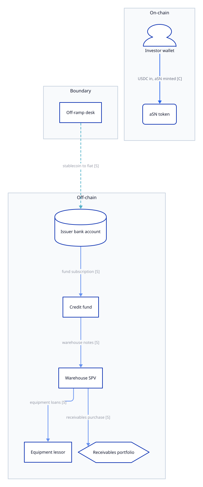
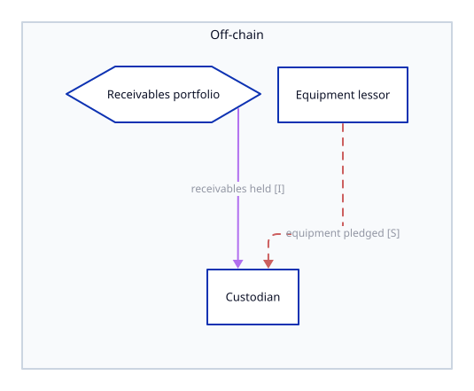
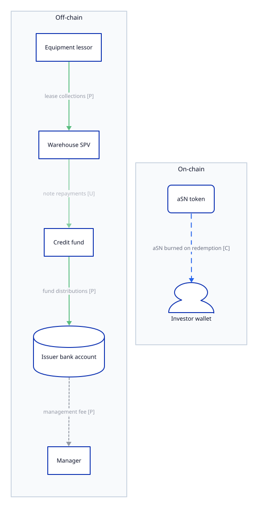

# RWA Due Diligence: Acme Yield

| field | value |
|---|---|
| slug | acme |
| root URL | https://acme-yield.example/ |
| run id | acme-20261001T080000Z |
| status | draft |
| rounds | 1 |
| started | 2026-10-01T08:00:00Z |
| finalized | -- |
| skill version | 0.6.0 |
| schema version | rwa-dd/2.1 |

> DRAFT -- not finalized

## 1. Executive summary and critical findings

Acme Yield offers two products: a note (P1) financing equipment leases through a credit fund and a warehouse SPV (T1), and a vault (P2) financing commodity purchase and resale (T2). Entities are mapped to layers; the security over the T1 loans is disputed between sources.

### T1 Acme equipment credit

| question | answer |
|---|---|
| Who holds investor capital? | E1 Acme Yield Issuer Ltd (L1) \[SELF\_REPORTED\] |
| Who deploys credit? | E5 Acme Credit Fund LP (L2) \[SELF\_REPORTED\] |
| Who receives financing? | E7 Example Equipment Lessors Ltd (L3) \[SELF\_REPORTED\]; E8 Example Receivables Originator (L3) \[SELF\_REPORTED\] |
| Who must repay? | E7 Example Equipment Lessors Ltd (L3) \[SELF\_REPORTED\]; E8 Example Receivables Originator (L3) \[SELF\_REPORTED\]; cash flows from: E10 (L3-O) \[SELF\_REPORTED\] |
| Who can enforce the claim? | E1 \[SELF\_REPORTED\]; Security agent E3 enforces on default \[SELF\_REPORTED\] |

### T2 Acme commodity trade finance

| question | answer |
|---|---|
| Who holds investor capital? | E1 Acme Yield Issuer Ltd (L1) \[INFERRED\] |
| Who deploys credit? | E1 Acme Yield Issuer Ltd (L1/L2) \[SELF\_REPORTED\]; E1 Acme Yield Issuer Ltd (L1/L2) \[SELF\_REPORTED; alt A1a\]; E1 Acme Yield Issuer Ltd (L1/L2) \[SELF\_REPORTED; alt A1b\] |
| Who receives financing? | E9 (L3) \[SELF\_REPORTED\]; E9 (L3) \[SELF\_REPORTED; alt A1a\]; E9 (L3) \[SELF\_REPORTED; alt A1b\] |
| Who must repay? | E9 (L3) \[SELF\_REPORTED\]; E9 (L3) \[SELF\_REPORTED; alt A1a\]; E9 (L3) \[SELF\_REPORTED; alt A1b\] |
| Who can enforce the claim? | UNRESOLVED |

### Critical findings

- **G1** [legal] [MATERIAL] [BLOCKING] Issuer financial statements and the custody agreement are not public. (S8)
- **G3** [credit] [BLOCKING] Perfection of the security interest over the leased equipment is not evidenced. (S8)

## 2. Framework completeness and portfolio

### Completeness

| strategy | K1 L1 legal counterparty | K2 L1->L2 legal claim | K3 L2->L3 method | K4 L2->L3 security | K5 Loss waterfall | K6 Holder look-through | K7 L3 business |
|---|---|---|---|---|---|---|---|
| T1 Acme equipment credit | CONFIRMED | SELF_REPORTED | SELF_REPORTED | CONFLICTING | SELF_REPORTED | SELF_REPORTED | SELF_REPORTED |
| T2 Acme commodity trade finance | CONFIRMED | UNRESOLVED | SELF_REPORTED | SELF_REPORTED | UNRESOLVED | INFERRED | SELF_REPORTED |

### Portfolio components

| strategy | component | products | business type | counted total |
|---|---|---|---|---|
| T1 Acme equipment credit | CORE_CREDIT | P1 | private\_credit [SELF_REPORTED] (S8) | 25000000 n/d |
| T2 Acme commodity trade finance | CORE_CREDIT | P2 | trade\_finance\_pt [INFERRED] (S7) -- Vault docs describe purchase and resale of goods. | -- |
| T3 Acme treasury sleeve | LIQUIDITY_SLEEVE | P2 | -- [UNRESOLVED] | 5000000 USD |

### Allocation

| strategy | interface | kind | amount | basis | counted | reason |
|---|---|---|---|---|---|---|
| T1 | X2 | L1_L2 | 25000000 | GROSS_FUNDED | yes | counted |
| T1 | X13 | asset_sale | 3000000 USD | SALE_PROCEEDS | no | basis SALE_PROCEEDS |
| T3 | X9 | sleeve_holding | 5000000 USD | GROSS_FUNDED | yes | counted |
| T3 | X10 | reserve_lookthrough | 5000000 USD | LOOKTHROUGH | no | basis LOOKTHROUGH |

## 3. Three-layer business model

### T1 Acme equipment credit

- Component: CORE_CREDIT
- Products: P1
- Business type: private\_credit [SELF_REPORTED] (S8)
- Sublayers: L2a credit fund; L2b warehouse SPV
- Chains:
  - P1 holders -\> \[DI\] -\> E1 Acme Yield Issuer Ltd (L1) -\> \[FUND; FI\] -\> E5 Acme Credit Fund LP (L2) -\> \[DI\] -\> E6 Acme Warehouse SPV Ltd (L2) -\> \[DL; secured\] -\> E7 Example Equipment Lessors Ltd (L3) -\> \[OTHER\] -\> E10 (L3-O)
  - P1 holders -\> \[DI\] -\> E1 Acme Yield Issuer Ltd (L1) -\> \[FUND; FI\] -\> E5 Acme Credit Fund LP (L2) -\> \[DI\] -\> E6 Acme Warehouse SPV Ltd (L2) -\> \[AP; ?\] -\> E8 Example Receivables Originator (L3)
  - P1 holders -\> \[DI\] -\> E1 Acme Yield Issuer Ltd (L1) -\> \[FUND; FI\] -\> E5 Acme Credit Fund LP (L2) -\> \[DI\] -\> E6 Acme Warehouse SPV Ltd (L2) -\> \[sale; true sale\] -\> E13 Example Loan Buyer Fund (transferee)

### T2 Acme commodity trade finance

- Component: CORE_CREDIT
- Products: P2
- Business type: trade\_finance\_pt [INFERRED] (S7) -- Vault docs describe purchase and resale of goods.
- Sublayers: --
- Chains:
  - P2 holders -\> \[OTHER\] -\> E1 Acme Yield Issuer Ltd (L1/L2) -\> \[PT; unsecured\] -\> E9 (L3)
  - P2 holders -\> \[OTHER\] -\> E1 Acme Yield Issuer Ltd (L1/L2) -\> \[REPO; secured; alt A1a\] -\> E9 (L3)
  - P2 holders -\> \[OTHER\] -\> E1 Acme Yield Issuer Ltd (L1/L2) -\> \[PT; unsecured; alt A1b\] -\> E9 (L3)

### T3 Acme treasury sleeve

- Component: LIQUIDITY_SLEEVE
- Products: P2
- Business type: -- [UNRESOLVED]
- Sublayers: --
- Chains:
  - E1 Acme Yield Issuer Ltd (L1) -\> \[OTHER\] -\> E11 Example Stablecoin Issuer Ltd (issuer) -\> \[look-through\] -\> E12 (reserve)

### Functions by entity

| entity | class | layer | role | strategy | evidence |
|---|---|---|---|---|---|
| E1 | legal_person | L1 | token_issuer | -- | S3, S8 |
| E1 | legal_person | L1 | holder_counterparty | -- | S8 |
| E1 | legal_person | L2 | lender_of_record | T2 | S7 |
| E2 | legal_person | L2 | credit_manager | T1 | S2, S8 |
| E3 | legal_person | L2 | security_agent | T1 | S8 |
| E4 | legal_person | L1 | protocol_operator | -- | S1 |
| E5 | legal_person | L2 | lender_of_record | T1 | S8 |
| E6 | legal_person | L2 | asset_holding_spv | T1 | S8 |
| E7 | legal_person | L3 | financing_recipient | T1 | S8 |
| E8 | legal_person | L3 | receivables_seller | T1 | S5 |
| E9 | unknown | L3 | financing_recipient | T2 | S7 |
| E10 | obligor_group | L3-O | contractual_obligor | T1 | S8 |
| E11 | legal_person | -- | issuer | T3 | S7 |
| E12 | unknown | -- | reserve_assets | T3 | S7 |
| E13 | legal_person | -- | loan_purchaser | T1 | S8 |
| E14 | legal_person | -- | protection_provider | T1 | S8 |

## 4. Capital allocation and credit deployment

### L1 -> L2

| id | strategy | from -> to | route | legal class | counterparty | instrument | claim holder | amount | basis | supply concentration | alternative | terms | governing law |
|---|---|---|---|---|---|---|---|---|---|---|---|---|---|
| X1 | T1 | P1 -\> E1 (holder\_L1) | -- [UNRESOLVED] | DI [SELF_REPORTED] (S8) | -- [UNRESOLVED] | Senior notes [SELF_REPORTED] (S8) | Noteholders [SELF_REPORTED] (S8) | -- [UNRESOLVED] | -- | -- [UNRESOLVED] | -- | Monthly redemption window [SELF_REPORTED] (S8) | Examplestan [SELF_REPORTED] (S8) |
| X2 | T1 | E1 -\> E5 (L1\_L2) | FUND [SELF_REPORTED] (S8) | FI [SELF_REPORTED] (S8) | E5 [SELF_REPORTED] (S8) | Limited partnership interests [SELF_REPORTED] (S8) | E1 [SELF_REPORTED] (S8) | 25000000 [SELF_REPORTED] (S8) | GROSS_FUNDED | -- [UNRESOLVED] | -- | -- [UNRESOLVED] | Examplestan [SELF_REPORTED] (S8) |
| X6 | T2 | P2 -\> E1 (holder\_L1) | -- [UNRESOLVED] | OTHER [INFERRED] (S7) -- Vault share is a contractual claim. | -- [UNRESOLVED] | Vault shares [SELF_REPORTED] (S7) | -- [UNRESOLVED] | -- [UNRESOLVED] | -- | -- [UNRESOLVED] | -- | -- [UNRESOLVED] | -- [UNRESOLVED] |

### L2 -> L3

| id | strategy | from -> to | method | legal class | counterparty | security | collateral | perfection | enforcement | recourse | amount | alternative | terms |
|---|---|---|---|---|---|---|---|---|---|---|---|---|---|
| X3 | T1 | E5 -\> E6 (within\_L2) | -- [UNRESOLVED] | DI [SELF_REPORTED] (S8) | -- [UNRESOLVED] | -- [UNRESOLVED] | -- [UNRESOLVED] | -- [UNRESOLVED] | -- [UNRESOLVED] | -- [UNRESOLVED] | -- [UNRESOLVED] | -- | -- [UNRESOLVED] |
| X4 | T1 | E6 -\> E7 (L2\_L3) | DL [SELF_REPORTED] (S8) | DL [SELF_REPORTED] (S8) | -- [UNRESOLVED] | secured [CONFLICTING] (S8) | Leased equipment [SELF_REPORTED] (S8) | -- [UNRESOLVED] (S8) -- No lien filing cited. | Security agent E3 enforces on default [SELF_REPORTED] (S8) | Full recourse to the lessor [SELF_REPORTED] (S8) | 10000000 [SELF_REPORTED] (S8) | -- | 36-month amortising, 12 percent [SELF_REPORTED] (S8) |
| X5 | T1 | E6 -\> E8 (L2\_L3) | AP [SELF_REPORTED] (S8) | AP [SELF_REPORTED] (S8) | -- [UNRESOLVED] | -- [UNRESOLVED] | -- [UNRESOLVED] (S8) -- No collateral beyond the receivables described. | -- [UNRESOLVED] | -- [UNRESOLVED] | -- [UNRESOLVED] (S5) -- Recourse to the seller not stated. | -- [UNRESOLVED] | -- | -- [UNRESOLVED] |
| X7 | T2 | E1 -\> E9 (L2\_L3) | PT [SELF_REPORTED] (S7) | OTHER [SELF_REPORTED] (S7) | -- [UNRESOLVED] | unsecured [SELF_REPORTED] (S7) | -- [UNRESOLVED] | -- [UNRESOLVED] | -- [UNRESOLVED] | -- [UNRESOLVED] | -- [UNRESOLVED] | -- | -- [UNRESOLVED] (S7) -- Trade terms not published. |
| X8 | T1 | E7 -\> E10 (L3\_L3O) | -- [UNRESOLVED] | OTHER [SELF_REPORTED] (S8) -- Equipment leases between the lessor and its lessees. | -- [UNRESOLVED] | -- [UNRESOLVED] | -- [UNRESOLVED] | -- [UNRESOLVED] | -- [UNRESOLVED] | -- [UNRESOLVED] | -- [UNRESOLVED] | -- | -- [UNRESOLVED] |
| X11 | T2 | E1 -\> E9 (L2\_L3) | REPO [SELF_REPORTED] (S7) | OTHER [SELF_REPORTED] (S7) | -- [UNRESOLVED] | secured [SELF_REPORTED] (S7) | -- [UNRESOLVED] | -- [UNRESOLVED] | -- [UNRESOLVED] | -- [UNRESOLVED] | 2000000 [SELF_REPORTED] (S7) | A1a | Historical repo terms [SELF_REPORTED] (S7) |
| X12 | T2 | E1 -\> E9 (L2\_L3) | PT [SELF_REPORTED] (S7) | OTHER [SELF_REPORTED] (S7) | -- [UNRESOLVED] | unsecured [SELF_REPORTED] (S7) | -- [UNRESOLVED] | -- [UNRESOLVED] | -- [UNRESOLVED] | -- [UNRESOLVED] | -- [UNRESOLVED] | A1b | Current live-rate terms [SELF_REPORTED] (S7) |

### Liquidity sleeves

| id | strategy | from -> to | legal class | instrument | amount | basis | terms |
|---|---|---|---|---|---|---|---|
| X9 | T3 | E1 -\> E11 (sleeve\_holding) | OTHER [SELF_REPORTED] (S7) | Stablecoin balances [SELF_REPORTED] (S7) | 5000000 [SELF_REPORTED] (S7) | GROSS_FUNDED | -- [UNRESOLVED] |
| X10 | T3 | E11 -\> E12 (reserve\_lookthrough) | -- [UNRESOLVED] | Short-dated government bills [SELF_REPORTED] (S7) | 5000000 [SELF_REPORTED] (S7) | LOOKTHROUGH | -- [UNRESOLVED] |

### Asset sales

| id | strategy | from -> to | title transfer | servicing | recourse | amount | basis | residual exposure |
|---|---|---|---|---|---|---|---|---|
| X13 | T1 | E6 -\> E13 (asset\_sale) | true sale [SELF_REPORTED] (S8) | Retained by E2 [SELF_REPORTED] (S8) | -- [UNRESOLVED] | 3000000 [SELF_REPORTED] (S8) | SALE_PROCEEDS | -- [UNRESOLVED] (S8) -- Not disclosed in the memorandum. |

## 5. Holder rights, default and recovery

### Holder rights: P1 Acme Senior Note

- Instrument nature: Senior notes issued by E1 [SELF_REPORTED] (S8)
- Claim against: E1 [SELF_REPORTED] (S8)
- Look-through: via\_spv [SELF_REPORTED] (S8) -- Notes are limited to the issuer SPV's assets.
- Recourse: Limited recourse [SELF_REPORTED] (S8)
- Governing law: Examplestan [SELF_REPORTED] (S8)
- Forum: -- [UNRESOLVED] (S8) -- No forum clause quoted.
- Insolvency protection: -- [UNRESOLVED] (S8) -- Not described.
- Disclaimers: Noteholders have no direct claim on borrowers [SELF_REPORTED] (S8)

### Holder rights: P2 Acme Treasury Vault

- Instrument nature: Vault shares [SELF_REPORTED] (S7)
- Claim against: -- [UNRESOLVED] (S7) -- Not stated.
- Look-through: unresolved [INFERRED] (S7) -- Docs describe no claim beyond the vault.
- Recourse: -- [UNRESOLVED]
- Governing law: -- [UNRESOLVED]
- Forum: -- [UNRESOLVED]
- Insolvency protection: -- [UNRESOLVED]
- Disclaimers: -- [UNRESOLVED]

### Default and recovery: T1 Acme equipment credit

- Events of default: Payment default continuing for 30 days [SELF_REPORTED] (S8)
- Enforcement: Security agent E3 enforces over the leased equipment [SELF_REPORTED] (S8)
- Loss waterfall (1 absorbs first): [SELF_REPORTED] (S8)
  1. Borrower equity
  2. Credit fund junior tranche
  3. Senior noteholders
- Recovery history: -- [UNRESOLVED] (S8) -- No recoveries reported.

### Default and recovery: T2 Acme commodity trade finance

- Events of default: -- [UNRESOLVED] (S7) -- Vault docs describe no default events.
- Enforcement: -- [UNRESOLVED]
- Loss waterfall (1 absorbs first): -- [UNRESOLVED] (S7) -- Vault docs do not describe loss order.
- Recovery history: -- [UNRESOLVED]

### Supports

| id | type | strategies | provider | beneficiary | covered exposure | trigger | coverage | exclusions | priority | enforceability | governing law | holder recourse |
|---|---|---|---|---|---|---|---|---|---|---|---|---|
| Z1 | CREDIT_ENHANCEMENT | T1 | E14 | E5 | Equipment loan principal [SELF_REPORTED] (S8) | Payment default continuing for 90 days [SELF_REPORTED] (S8) | Up to 20 percent of principal [SELF_REPORTED] (S8) | -- [UNRESOLVED] (S8) -- Not disclosed in the memorandum. | -- [UNRESOLVED] | -- [UNRESOLVED] | Examplestan [SELF_REPORTED] (S8) | -- [UNRESOLVED] (S8) -- Noteholders are not named as insured. |

## 6. Material gaps and issuer requests

### Material and blocking gaps

- **G1** [legal] [MATERIAL] [BLOCKING] Issuer financial statements and the custody agreement are not public. (S8)
- **G3** [credit] [BLOCKING] Perfection of the security interest over the leased equipment is not evidenced. (S8)

### Scope unresolved

- **U1** [credit] The memorandum and the independent review may describe different coverage periods of the credit insurance. (S5, S8) -- subjects: Z1.coverage

### Discrepancies

- **D1** [yield] Archived docs state a 0.30 percent vault fee; the current site states no fee. (S1, S7) -- scope: Both state the vault fee charged to P2 holders; S7 is the March 2026 version.
- **D2** [credit] The memorandum describes the equipment loans as secured; the independent review describes them as unsecured. (S5, S8) -- subjects: X4.security -- scope: Both describe the security of the X4 equipment loans as currently documented.

### Issuer requests

- **Q1** (priority 1) Security agreement and lien filings for the equipment loans -- Confirm whether the T1 loans are secured and the security interest is perfected (answers C2, C5)
- **Q2** (priority 2) Commodity purchase and offtake contracts for the trade vault -- Identify the T2 counterparties and how the L3 business generates cash (answers A4, E1, E2)

## Appendix A. Legal entity register

| entity | class | legal name | jurisdiction | type | registration | licence status |
|---|---|---|---|---|---|---|
| E1 | legal_person | Acme Yield Issuer Ltd [CONFIRMED] (S3) | Examplestan [CONFIRMED] (S3) | private limited company [CONFIRMED] (S3) | 100200 [CONFIRMED] (S3) | -- [UNRESOLVED] (S2) -- No licence entry found for the issuer. |
| E2 | legal_person | Acme Asset Management LLC [CONFIRMED] (S2) | Examplestan [INFERRED] (S2) -- Regulator only licenses local entities. | limited liability company [SELF_REPORTED] (S8) | -- [UNRESOLVED] | active [CONFIRMED] (S2) |
| E3 | legal_person | Example Custody Trust Co [SELF_REPORTED] (S8) | -- [UNRESOLVED] (S8) -- Memorandum names the custodian but not its jurisdiction. | trust company [INFERRED] (S5) -- Name suggests a trust company. | -- [UNRESOLVED] | -- [UNRESOLVED] |
| E4 | legal_person | Acme Labs Inc [SELF_REPORTED] (S1) | -- [UNRESOLVED] | -- [UNRESOLVED] | -- [UNRESOLVED] | -- [UNRESOLVED] |
| E5 | legal_person | Acme Credit Fund LP [SELF_REPORTED] (S8) | Examplestan [SELF_REPORTED] (S8) | limited partnership [SELF_REPORTED] (S8) | -- [UNRESOLVED] | -- [UNRESOLVED] |
| E6 | legal_person | Acme Warehouse SPV Ltd [SELF_REPORTED] (S8) | -- [UNRESOLVED] | private limited company [SELF_REPORTED] (S8) | -- [UNRESOLVED] | -- [UNRESOLVED] |
| E7 | legal_person | Example Equipment Lessors Ltd [SELF_REPORTED] (S8) | -- [UNRESOLVED] | -- [UNRESOLVED] | -- [UNRESOLVED] | -- [UNRESOLVED] |
| E8 | legal_person | Example Receivables Originator [INFERRED] (S5) -- Named as receivables seller in the review. | -- [UNRESOLVED] | -- [UNRESOLVED] | -- [UNRESOLVED] | -- [UNRESOLVED] |
| E9 | unknown | -- [UNRESOLVED] (S7) -- Vault docs do not name the commodity buyer. | -- [UNRESOLVED] | -- [UNRESOLVED] | -- [UNRESOLVED] | -- [UNRESOLVED] |
| E10 | obligor_group | -- [UNRESOLVED] | -- [UNRESOLVED] | -- [UNRESOLVED] | -- [UNRESOLVED] | -- [UNRESOLVED] |
| E11 | legal_person | Example Stablecoin Issuer Ltd [SELF_REPORTED] (S7) | -- [UNRESOLVED] | -- [UNRESOLVED] | -- [UNRESOLVED] | -- [UNRESOLVED] |
| E12 | unknown | -- [UNRESOLVED] | -- [UNRESOLVED] | -- [UNRESOLVED] | -- [UNRESOLVED] | -- [UNRESOLVED] |
| E13 | legal_person | Example Loan Buyer Fund [SELF_REPORTED] (S8) | -- [UNRESOLVED] | -- [UNRESOLVED] | -- [UNRESOLVED] | -- [UNRESOLVED] |
| E14 | legal_person | Example Credit Insurer plc [SELF_REPORTED] (S8) | -- [UNRESOLVED] | -- [UNRESOLVED] | -- [UNRESOLVED] | -- [UNRESOLVED] |

Licences:

| entity | regulator | licence type | licence id | licence status |
|---|---|---|---|---|
| E2 | Examplestan Financial Authority [CONFIRMED] (S2) | fund manager [CONFIRMED] (S2) | AAM-0042 [CONFIRMED] (S2) | active [CONFIRMED] (S2) |

## Appendix B. L3 business

### T1 Acme equipment credit

- Description: Equipment leasing to mid-size manufacturers [SELF_REPORTED] (S8)
- Revenue model: Monthly lease payments from lessees [SELF_REPORTED] (S8)
- Cash generation: Lease collections paid to the warehouse SPV [SELF_REPORTED] (S8)
- Collections control: Collection account controlled by the security agent [INFERRED] (S5) -- Review mentions a third-party custodian over the receivables.
- Concentration: Top ten lessees about 40 percent of the book [THIRD_PARTY_REPORTED] (S5)
- Performance: -- [UNRESOLVED] (S8) -- No delinquency or default data published.
- Operating history: Leasing since 2019 [SELF_REPORTED] (S1)

### T2 Acme commodity trade finance

- Description: Purchase and resale of agricultural commodities [SELF_REPORTED] (S7)
- Revenue model: -- [UNRESOLVED] (S7) -- Margin on resale not described.
- Cash generation: -- [UNRESOLVED]
- Collections control: -- [UNRESOLVED]
- Concentration: -- [UNRESOLVED]
- Performance: -- [UNRESOLVED]
- Operating history: -- [UNRESOLVED]

## Appendix C. Fund flows

Nodes:

| id | label | lane | layer | kind | chain | ref |
|---|---|---|---|---|---|---|
| n1 | Investor wallet | onchain | -- | investor | ethereum | -- |
| n2 | aSN token | onchain | L1 | contract | ethereum | 0x00000000000000000000000000000000000000a1 |
| n3 | Treasury vault | onchain | L1 | pool | ethereum | P2 |
| n4 | Ops multisig | onchain | -- | multisig | ethereum | 0x00000000000000000000000000000000000000b2 |
| n5 | Off-ramp desk | boundary | -- | entity | -- | E4 |
| n6 | Issuer bank account | offchain | L1 | bank_account | -- | E1 |
| n7 | Custodian | offchain | L2 | entity | -- | E3 |
| n8 | Receivables portfolio | offchain | L3 | asset | -- | -- |
| n9 | Manager | offchain | L2 | entity | -- | E2 |
| n10 | Credit fund | offchain | L2 | entity | -- | E5 |
| n11 | Warehouse SPV | offchain | L2 | entity | -- | E6 |
| n12 | Equipment lessor | offchain | L3 | entity | -- | E7 |
| n13 | Commodity buyer | offchain | L3 | entity | -- | E9 |

### T1 Acme equipment credit -- settlement

| from | to | kind | mechanism | rail | interface | label | claim |
|---|---|---|---|---|---|---|---|
| n1 Investor wallet | n2 aSN token | subscription | deposit | stablecoin | X1 | USDC in, aSN minted | true [CONFIRMED] (S4) |
| n5 Off-ramp desk | n6 Issuer bank account | conversion | conversion | fiat_wire | -- | stablecoin to fiat | true [SELF_REPORTED] (S1) |
| n6 Issuer bank account | n10 Credit fund | subscription | purchase | fiat_wire | X2 | fund subscription | true [SELF_REPORTED] (S8) |
| n10 Credit fund | n11 Warehouse SPV | subscription | drawdown | fiat_wire | X3 | warehouse notes | true [SELF_REPORTED] (S8) |
| n11 Warehouse SPV | n12 Equipment lessor | subscription | drawdown | fiat_wire | X4 | equipment loans | true [SELF_REPORTED] (S8) |
| n11 Warehouse SPV | n8 Receivables portfolio | subscription | purchase | fiat_wire | X5 | receivables purchase | true [SELF_REPORTED] (S8) |

### T1 Acme equipment credit -- claim

| from | to | kind | mechanism | rail | interface | label | claim |
|---|---|---|---|---|---|---|---|
| n12 Equipment lessor | n7 Custodian | collateral | pledge | internal | X4 | equipment pledged | true [SELF_REPORTED] (S8) |
| n8 Receivables portfolio | n7 Custodian | custody | title_transfer | internal | X5 | receivables held | true [INFERRED] (S5) -- Review mentions a custodian. |

### T1 Acme equipment credit -- repayment

| from | to | kind | mechanism | rail | interface | label | claim |
|---|---|---|---|---|---|---|---|
| n12 Equipment lessor | n11 Warehouse SPV | yield | repayment | fiat_wire | X4 | lease collections | true [SELF_REPORTED] (S8) |
| n11 Warehouse SPV | n10 Credit fund | yield | repayment | fiat_wire | X3 | note repayments | -- [UNRESOLVED] (S8) -- Memorandum does not describe this hop. |
| n10 Credit fund | n6 Issuer bank account | yield | distribution | fiat_wire | X2 | fund distributions | true [SELF_REPORTED] (S8) |
| n6 Issuer bank account | n9 Manager | fee | fee_payment | fiat_wire | -- | management fee | true [SELF_REPORTED] (S8) |
| n2 aSN token | n1 Investor wallet | redemption | burn | burn | X1 | aSN burned on redemption | true [CONFIRMED] (S4) |

### T2 Acme commodity trade finance -- settlement

| from | to | kind | mechanism | rail | interface | label | claim |
|---|---|---|---|---|---|---|---|
| n5 Off-ramp desk | n6 Issuer bank account | conversion | conversion | fiat_wire | -- | stablecoin to fiat | true [SELF_REPORTED] (S1) |
| n1 Investor wallet | n3 Treasury vault | subscription | deposit | stablecoin | X6 | vault deposit | true [SELF_REPORTED] (S7) |
| n3 Treasury vault | n4 Ops multisig | collateral | pledge | internal | -- | reserve pledge | -- [UNRESOLVED] (S4) -- No pledge transfer observed on-chain. |
| n6 Issuer bank account | n13 Commodity buyer | subscription | purchase | fiat_wire | X7 | goods purchased | -- [UNRESOLVED] |
| n3 Treasury vault | n1 Investor wallet | yield | distribution | stablecoin | X6 | daily yield | true [SELF_REPORTED] (S7) |

### T2 Acme commodity trade finance -- claim

- none

### T2 Acme commodity trade finance -- repayment

- none

### T3 Acme treasury sleeve -- settlement

- none

### T3 Acme treasury sleeve -- claim

- none

### T3 Acme treasury sleeve -- repayment

- none

## Appendix D. Yield, fees and redemption

### Yield P1 Acme Senior Note

- Mechanism: Interest on receivables purchased at a discount [SELF_REPORTED] (S8)
- Gross yield: 11.0 percent [SELF_REPORTED] (S1)
- Net yield to holder: 9.5 percent [SELF_REPORTED] (S1)
- Distribution method: rebasing [CONFIRMED] (S4)
- Distribution frequency: monthly [SELF_REPORTED] (S8)

Underlying:

| description | asset class | share pct | location |
|---|---|---|---|
| Short-dated trade receivables [SELF_REPORTED] (S8) | trade receivables [SELF_REPORTED] (S8) | 100 [SELF_REPORTED] (S8) | -- [UNRESOLVED] (S8) -- Receivables jurisdiction not stated. |

Fees:

| type | rate | recipient |
|---|---|---|
| management [SELF_REPORTED] (S8) | 1.5 percent p.a. [SELF_REPORTED] (S8) | E2 [SELF_REPORTED] (S8) |

### Yield P2 Acme Treasury Vault

- Mechanism: Resale margin passed through the vault [SELF_REPORTED] (S7)
- Gross yield: -- [UNRESOLVED]
- Net yield to holder: 4.1 percent [SELF_REPORTED] (S1)
- Distribution method: claim [SELF_REPORTED] (S7)
- Distribution frequency: daily [SELF_REPORTED] (S7)

Underlying:

| description | asset class | share pct | location |
|---|---|---|---|
| Commodity purchase and resale contracts [SELF_REPORTED] (S7) | trade finance [SELF_REPORTED] (S7) | -- [UNRESOLVED] | -- [UNRESOLVED] |

Fees:

| type | rate | recipient |
|---|---|---|
| vault [SELF_REPORTED] (S7) | 0.30 percent [SELF_REPORTED] (S7) | -- [UNRESOLVED] |

### Redemption

| product | mechanism | queue | settlement time | gating | fees |
|---|---|---|---|---|---|
| P1 | redemption request to issuer [SELF_REPORTED] (S8) | monthly window [SELF_REPORTED] (S8) | 2 business days [INFERRED] (S6) -- Stated on an analyst call only. | issuer may suspend redemptions [SELF_REPORTED] (S8) | -- [UNRESOLVED] (S8) -- No redemption fee stated. |
| P2 | instant burn against vault liquidity [SELF_REPORTED] (S7) | -- [UNRESOLVED] | -- [UNRESOLVED] | -- [UNRESOLVED] | -- [UNRESOLVED] |

### Eligibility

| product | restrictions |
|---|---|
| P1 | professional investors only [SELF_REPORTED] (S8) |
| P2 | -- [UNRESOLVED] (S1) -- Site does not state restrictions. |

## Appendix E. On-chain contracts and control

| chain | address | role | source verified | proxy | upgrade admin | role admins | timelock delay s | multisig | threshold | signers |
|---|---|---|---|---|---|---|---|---|---|---|
| ethereum | 0x00000000000000000000000000000000000000a1 | aSN token [CONFIRMED] (S4) | true [CONFIRMED] (S4) | TransparentUpgradeableProxy [CONFIRMED] (S4) | 0x00000000000000000000000000000000000000b2 [CONFIRMED] (S4) | 0x00000000000000000000000000000000000000b2 [CONFIRMED] (S4) | 0 [CONFIRMED] (S4) -- No timelock between admin and proxy. | 0x00000000000000000000000000000000000000b2 [CONFIRMED] (S4) | 2 [CONFIRMED] (S4) | 3 [CONFIRMED] (S4) |

## Appendix F. All findings

### Gaps

- **G1** [legal] [MATERIAL] [BLOCKING] Issuer financial statements and the custody agreement are not public. (S8)
  - **N1** Custody agreement and issuer accounts -- Company registry filings -- Confirm custody and financials (resolves G1; est 6 calls)
- **G2** [yield] Gross yield of the Treasury Vault is not disclosed. (S1, S7)
- **G3** [credit] [BLOCKING] Perfection of the security interest over the leased equipment is not evidenced. (S8)
  - **N3** Lien filings over the leased equipment -- Examplestan collateral registry -- Resolve the secured/unsecured discrepancy (resolves G3, D2; est 3 calls)

### Discrepancies

- **D1** [yield] Archived docs state a 0.30 percent vault fee; the current site states no fee. (S1, S7) -- scope: Both state the vault fee charged to P2 holders; S7 is the March 2026 version.
- **D2** [credit] The memorandum describes the equipment loans as secured; the independent review describes them as unsecured. (S5, S8) -- subjects: X4.security -- scope: Both describe the security of the X4 equipment loans as currently documented.

### Scope unresolved

- **U1** [credit] The memorandum and the independent review may describe different coverage periods of the credit insurance. (S5, S8) -- subjects: Z1.coverage

### Structural changes

- **C1** [onchain] Upgrade admin changed from a single key to a 2-of-3 multisig. (S4)

### Open questions

- [legal] Which entity holds legal title to the receivables?
- [redemption] Can the issuer suspend redemptions without notice?

## Appendix G. History

| date | change | evidence |
|---|---|---|
| 2026-03-01 | Vault fee stated as 0.30 percent in archived docs. | S7 |
| 2026-09-15 | Upgrade admin moved to a 2-of-3 multisig. | S4 |

## Appendix H. Audits and size

### Audits

| auditor | scope | date | report |
|---|---|---|---|
| Example Audit Partners [SELF_REPORTED] (S1) | aSN token contract [SELF_REPORTED] (S1) | 2026-02-15 [SELF_REPORTED] (S1) | -- |

### Size

| product | metric | value | as of |
|---|---|---|---|
| P1 | supply | 12500000 [CONFIRMED] (S4) | 2026-10-01 |
| P2 | tvl | 3400000 [SELF_REPORTED] (S1) | 2026-10-01 |
| -- | originated | 48000000 [SELF_REPORTED] (S1) | -- |

## Appendix I. Sources

| id | type | origin | fetch | retrieved | title/url | note |
|---|---|---|---|---|---|---|
| S1 | project_site | first_party | ok | 2026-10-01T08:00:00Z | Acme Yield - Home -- https://acme-yield.example/ |  |
| S2 | regulator_registry | regulator | ok | 2026-10-01T08:05:00Z | Register entry: Acme Asset Management LLC -- https://regulator.example/register/AAM-0042 |  |
| S3 | company_registry | registry | ok | 2026-10-01T08:10:00Z | Company record: Acme Yield Issuer Ltd -- https://companies.example/entity/ACME-SPV-1 |  |
| S4 | onchain_explorer | onchain | ok | 2026-10-01T08:15:00Z | Explorer: aSN token contract -- https://explorer.example/address/0x00000000000000000000000000000000000000a1 |  |
| S5 | third_party_research | third_party | ok | 2026-10-01T08:20:00Z | Independent review of Acme Yield -- https://research.example/acme-yield-review |  |
| S6 | analyst_input | analyst | offline | -- | Analyst call with Acme team -- analyst-call-notes-r1 | Notes from a call; not independently checked. |
| S7 | project_docs | first_party | archived (version 2026-03-01) | 2026-10-01T08:30:00Z | Acme Treasury Vault docs (archived) -- https://web.archive.example/2026-03-01/https://docs.acme-yield.example/vault |  |
| S8 | legal_doc | first_party | pdf | 2026-10-01T08:40:00Z | Offering memorandum (Acme Senior Note) -- https://acme-yield.example/legal/offering-memorandum.pdf |  |

## Appendix J. Analyst interventions

- none

## Appendix K. Unmapped facts

- The team plans a second chain deployment in 2027. (S1) -- why unmapped: Forward-looking statement; no schema field.

## Appendix L. Legend

- Claim cell: `value [FLAG] (evidence) -- note`; `--` means no value.
- CONFIRMED: direct, sufficient evidence for the precise claim within its stated scope (legal facts: regulator, registry, auditor or on-chain sources only).
- SELF_REPORTED: stated by the issuer, protocol, borrower or another interested party.
- THIRD_PARTY_REPORTED: reported by a third party; its scope and authority still need assessing.
- INFERRED: the analyst's conclusion from cited facts; the note states the reasoning.
- UNRESOLVED: not found in the cited sources, or not searched when no source is cited.
- CONFLICTING: named by a discrepancy finding about the same fact, timeframe and scope (see Appendix F); scope-unresolved findings never make a claim CONFLICTING.
- Layers are functions inside one strategy, by position in its financing chain: L1 on-chain capital vault; L2 credit financing layer; L3 underlying business layer.
- L3-O: optional sub-layer of parties downstream of L3 whose payments repay it; roles contractual_obligor (a document shows they legally owe L3), cash_flow_source (business cash flows) and offtaker_customer (buyers of goods, services or compute); linked by L3_L3O interfaces.
- Route (L1->L2): POOL supply to a shared lending pool; FUND subscription to a fund or vehicle; DIRECT financing of the credit counterparty itself; WRAPPER a position in another vault or token that holds the exposure.
- Method (L2->L3): DL direct loan; DI debt instrument (note, bond); AP purchase of receivables or other assets; PI participation interest; REPO repurchase agreement; PT principal purchase and resale (trade finance); OTHER other method.
- Legal class: DL loan claim; DI debt instrument claim; AP ownership of purchased assets; PI participation interest; FI fund interest; EI equity interest; PROTOCOL_ENTITLEMENT a pool receipt or other protocol-enforced entitlement; OTHER other or contractual claim.
- Components: CORE_CREDIT an underlying real-world financing business; LIQUIDITY_SLEEVE undeployed cash or stablecoin (issuer and reserves, no L3); DEFI_LENDING lending-market supply with protocol-enforced entitlements.
- Amount bases: GROSS_FUNDED funded principal; COMMITMENT committed, not necessarily funded; LOOKTHROUGH exposure seen through a held instrument; RESERVE reserve assets of an issuer; SALE_PROCEEDS proceeds of an asset sale.
- Counting rule: only GROSS_FUNDED amounts on L1_L2 and sleeve_holding interfaces outside alternative groups are counted; everything else is linked, not summed.
- Alternative tag: `alt A1a` marks option a of alternative group A1, competing legal paths for one position; they are never parallel exposures and are not counted.
- Flow views: settlement (capital and asset movement); claim (legal rights and collateral); repayment (cash back to L2 and L1, fees, enforcement path).
- Lanes: offchain, boundary (conversion, bridge and custody hand-off points), onchain.
- Diagram suffixes: [C] CONFIRMED, [S] SELF_REPORTED, [T] THIRD_PARTY_REPORTED, [I] INFERRED, [U] UNRESOLVED ([U?] not searched), [X] CONFLICTING.
- Findings: G gap, D discrepancy, U scope unresolved, C structural change; issuer requests Q cite the research question codes they answer. No risk scores are given.
